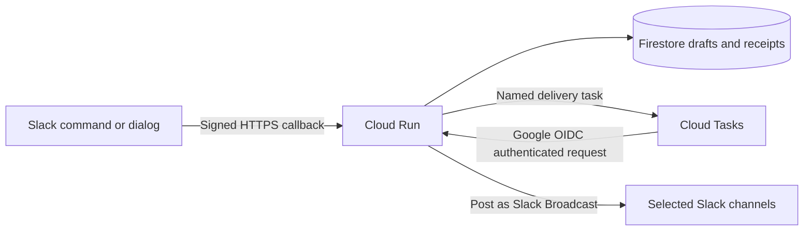

# Cloud Run deployment

The cloud version uses Slack HTTP callbacks and request-based Cloud Run billing with **minimum instances 0**. It can scale down to zero between uses. This is an efficient configuration for an app that sends communications occasionally.

The local Socket Mode version remains available with `npm start`. The container runs the HTTP version (`src/cloud-app.js`). Its Dockerfile uses Chainguard's public `node:latest-dev` build/test stage and `node:latest` runtime, without digest pins on the base images. These tags currently supply Node.js 26. The runtime runs as UID/GID 65532, inherits `/usr/bin/node` as its entrypoint, and receives `src/cloud-app.js` as its command. The free runtime includes npm and a shell; the separately restricted `-slim` variant is not used.

## Architecture



Slack requests save/review drafts and queue confirmed broadcasts before returning their acknowledgement. A separate Cloud Tasks HTTP request holds Cloud Run CPU while the messages are delivered. There is no background delivery after an HTTP response, continuously running worker, or periodic keep-alive request.

## Cost settings

| Resource | Prepared configuration |
| --- | --- |
| Cloud Run | Request-based billing, 0 minimum instances, up to 2 instances per revision, 1 vCPU / 512 MiB, startup CPU boost |
| Cloud Tasks | One task per confirmed broadcast, up to 2 deliveries active, retries only for interrupted processing |
| Firestore | Regional default Native database; shared drafts, job state, and latest-result pointers |
| Slack credentials | Two dedicated Secret Manager secrets |
| Container storage | Dedicated Artifact Registry repository in your deployment region, with optional customer-managed KMS encryption |

At light usage, much of the compute, task, and database activity can fit within available free quotas. Free quotas may already be consumed by other workloads. Secret storage/access, image storage, builds, logs, networking, and Firestore TTL deletions can still incur charges. This is a usage-based setup, not a guaranteed zero-dollar bill. The instance maximum is a capacity control, not a hard spending cap.

Sources: [Cloud Run billing](https://docs.cloud.google.com/run/docs/configuring/billing-settings), [Cloud Run pricing](https://cloud.google.com/run/pricing), [Cloud Tasks pricing](https://cloud.google.com/tasks/pricing), [Firestore pricing](https://cloud.google.com/firestore/pricing).

Scaling to zero introduces cold starts. Slack expects interaction acknowledgements within three seconds, so an occasional initial command can time out after an idle period or during a slow Google API call. Retry `/broadcast` if that occurs; confirming the same draft uses the same job/task ID. If experience later requires a warm instance, increasing the minimum to 1 changes the cost model. Keep storage, task queue, and runtime in the same GCP region to minimize cross-region latency.

## Service Endpoint

When deployed to Cloud Run, Google assigns a service URL formatted like:

```text
https://<service-name>-<hash>.<region>.run.app
```

This URL serves as your `SERVICE_URL` when generating the Slack app manifest and configuring event callbacks.

## Prepare Slack and the container

1. Create the custom Slack app from `manifest.json` if it does not exist yet. It can initially use the local manifest; the HTTP settings are applied below.
2. Obtain its bot token (`xoxb-…`) under **OAuth & Permissions** and signing secret under **Basic Information → App Credentials**. The HTTP version does not need an `xapp-…` Socket Mode token.
3. Keep those two values on the Slack settings pages until Terraform has created their empty Secret Manager containers. Add the values out of band as described below. Keep values out of Terraform variables, source files, and shell command arguments. The second-stage deployment references version `1`; change the version inputs if needed.
4. Identify the Slack workspace ID and set it in a local copy of `terraform/terraform.tfvars`. Approved senders and administrators can be configured there. Empty or missing Firestore sender state denies sending.
5. Build a Linux amd64 container and push it to your Artifact Registry repository using your normal image publishing workflow. For example:

   ```sh
   gcloud auth configure-docker <region>-docker.pkg.dev
   docker buildx build --platform linux/amd64 \
     --tag <region>-docker.pkg.dev/<project-id>/slack-broadcast/communications:v0.1.0 \
     --push .
   ```

   Use the resulting immutable app image digest for the `image` variable. The Dockerfile's verification stage runs the full test suite before the runtime image is produced. The build allowlists contain the application, tests, Slack manifest, placeholder cloud environment template, and non-secret Terraform policy files used by tests. Actual environment files, state, plans, and secret payloads are excluded. Only the app's package manifest, installed dependencies, and source are copied from the verification stage into the runtime image.

## Review and apply infrastructure

Terraform is prepared under `terraform/`. Stage one creates the empty Secret Manager containers, queue, service accounts, Firestore database (optional), TTL policies, and runtime bindings. Stage two creates Cloud Run after the image, workspace ID, and secret versions are ready. Terraform stores secret container metadata, IAM bindings, and version references; it never receives secret payloads and contains no secret-version resource or secret payload data source.

First, prepare the infrastructure with `deploy_app = false` (the default in `terraform.tfvars.example`):

```sh
cd terraform
terraform init
terraform plan -out=bootstrap.tfplan
# Review the infrastructure changes, then apply when ready.
terraform apply bootstrap.tfplan
```

Open [Secret Manager in the Google Cloud Console](https://console.cloud.google.com/security/secret-manager). Add version 1 to **slack-broadcast-bot-token** using the new app's `xoxb-…` token, and version 1 to **slack-broadcast-signing-secret** using its signing secret. Use the console's value field or your approved secure CI workflow; never pass values to Terraform. The empty containers have deletion protection, and Cloud Run reads the referenced versions at runtime.

Resolve the workspace ID using the helper below, build/publish the image, and then prepare the second-stage plan:

```sh
cd terraform
cp terraform.tfvars.example terraform.tfvars
# Fill in the workspace ID, approved senders, and image digest; set deploy_app = true.
terraform plan -out=deployment.tfplan
# Review the resulting changes before deployment.
terraform apply deployment.tfplan
```

The second stage sets `deploy_app = true` and requires the real image digest and workspace ID. Keep the pinned version numbers aligned with the versions populated out of band. Use your organization's approved Terraform state backend before a shared deployment. The provided Terraform uses local state unless you configure a backend. The Firestore database has deletion protection and an ABANDON deletion policy to preserve its data if this configuration is removed.

The Cloud Run endpoint must be reachable from Slack. Terraform uses `invoker_iam_disabled = true` for this service; the application verifies Slack's signature and recent timestamp on `/slack/events`. `/tasks/deliver` separately requires a verified Google ID token for the dedicated task service account, with the service URL as audience. The per-service public setting follows [Google's documented public-access method](https://docs.cloud.google.com/run/docs/authenticating/public).

Terraform initializes `slackBroadcastAccess/{workspace ID}` with the approved senders and then ignores changes to that document's fields. Home owns subsequent sender changes, which take effect without redeployment. Administrator IDs remain in the deployment's `SLACK_ADMIN_USER_IDS`. Administrators may remove their own sending access while retaining the ability to manage the list. The access record includes the most recent 100 grant/removal events with actor and timestamp. It is preserved when its Terraform resource is removed.

If using Slack Enterprise Grid, your browser URL shows the Enterprise organization ID (e.g. `E0123456789`). After the new bot token is in Secret Manager, resolve the actual installed workspace without displaying the token:

```sh
GOOGLE_CLOUD_PROJECT=your-project-id \
SLACK_BOT_TOKEN_SECRET=slack-broadcast-bot-token \
SLACK_ENTERPRISE_ID=E0123456789 \
npm run workspace:info
```

The helper prints only the workspace ID/name and Enterprise ID. It also checks that the token belongs to the specified Enterprise organization. Use its `workspace_id` in the Terraform input. The app currently installs into one workspace inside the organization.

The Cloud Tasks API normally provisions its primary service agent automatically. Ensure that `service-<PROJECT_NUMBER>@gcp-sa-cloudtasks.iam.gserviceaccount.com` retains its standard Cloud Tasks Service Agent role so it can mint the OIDC tokens. The runtime account is granted permission to enqueue and act as the dedicated task identity.

## Apply HTTP Slack settings

After deployment, generate a manifest for the actual service URL. Tokens are not needed to generate this file:

```sh
APP_TRANSPORT=http \
SERVICE_URL=https://<your-service-url>.run.app \
SLACK_APP_NAME='Slack Broadcast' \
npm run manifest
```

Paste `manifest.generated.json` into **App Manifest** in your Slack app settings, review, and save. It disables Socket Mode and sets the slash-command, interactivity, and Events API URLs to `/slack/events`. It enables the Home tab and subscribes to `app_home_opened`. Its bot scopes are `commands`, `chat:write`, `channels:read`, and `groups:read`. The metadata scopes support channel membership checks; they do not grant message-history access. Reinstall if scopes changed from a previous manifest. Invite the app to destination channels and open its Home tab.

The service environment contains the app name, Slack workspace ID, administrator member IDs, project/region, task queue, and service URL. Its token and signing secret are injected from Secret Manager. Sender-list changes use Firestore immediately; administrator-list changes take effect with a new deployment revision.

## Delivery and retention

- Firestore transactions prevent two instances from confirming or processing the same broadcast concurrently. Named tasks make queue creation safe to repeat after a lost response.
- Worker requests have a 300-second deadline and a 10-minute lease. After an interrupted request, a later task attempt waits for the lease to expire, marks any in-flight channel as unconfirmed, and resumes only recipients that were never started. Successful channels are never resent automatically.
- Cloud delivery does not wait through Slack rate limits. A rejected channel is shown as failed, saving billed request time; send again to that channel later if needed.
- A completed worker attempts to update the results dialog. If the dialog was closed, use `/broadcast status`. A **Refresh results** button also reads the latest saved status.
- Unlike local Socket Mode, cloud operation persists message text while it is a draft or pending job so another instance can continue the work. Text is removed from the draft when confirmed and from the job when complete. Drafts are logically expired after 30 minutes and become eligible for TTL deletion after one day. Job receipts become eligible after 30 days. Firestore TTL deletion is asynchronous and billed; user pointers contain up to five recent job IDs.
- Shared channel groups persist until removed, including group names, channel IDs, creator/updater IDs, timestamps, and an edit version. Approved sender IDs, the last 100 access changes, and latest-result pointers persist with the access configuration. These records do not contain message text.
- Home displays Compose, Shared Groups, the sender's five recent receipts, and—only for app administrators—Approved Senders. Inaccessible private channels are hidden in group editing and preserved on save. A group cannot be used until all its destinations are accessible to both sender and app. Sender approval and channel access are checked again for queued delivery; approval is rechecked before each new destination send.
- A storage or network failure after Slack accepts a message can leave its delivery unconfirmed. Check that channel before sending a new copy.

## Local validation

```sh
npm test
terraform -chdir=terraform init -backend=false
terraform -chdir=terraform validate
```

Tests use local HTTP requests and fake Google/Slack clients. They never post to Slack or modify cloud resources. A live deployment still needs a final installation check in the intended Slack workspace.
